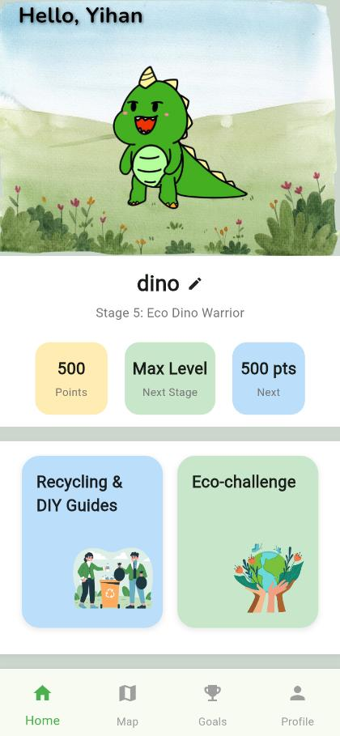
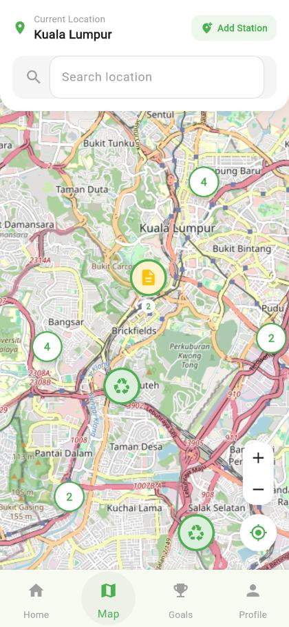
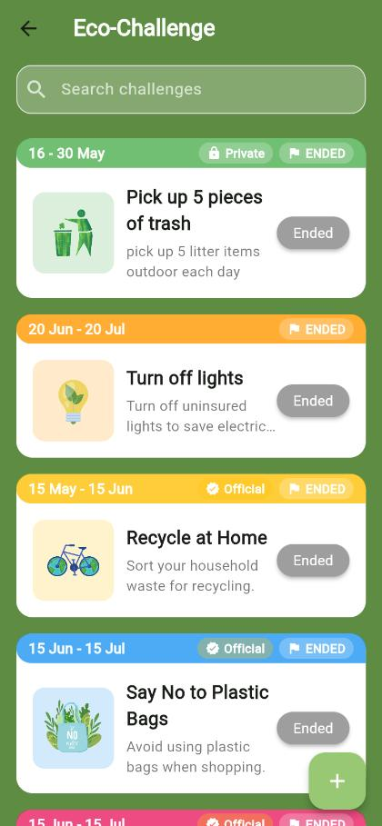
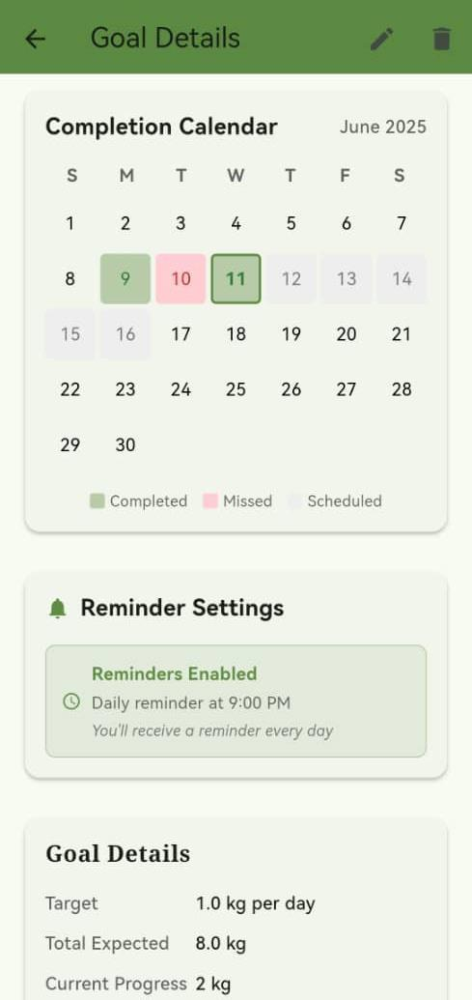
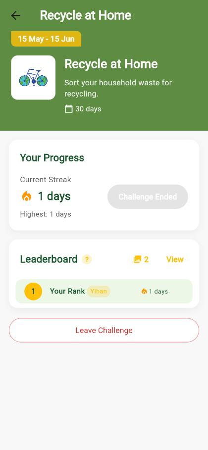
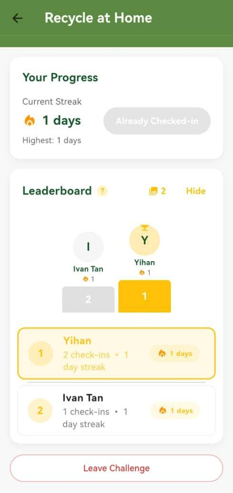
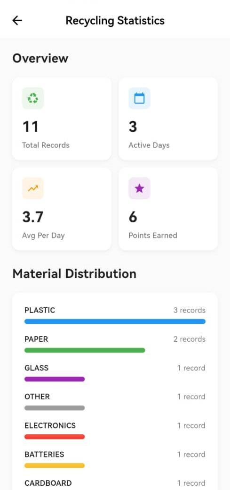
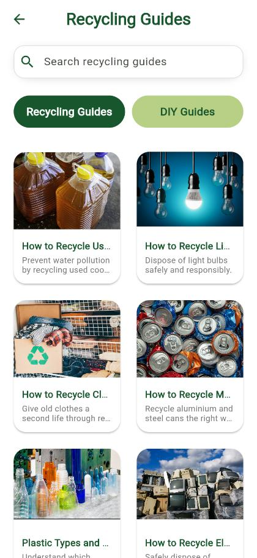

# Dino Track 🦕♻️

A Flutter app that makes recycling in Malaysia easier and more fun. Users
find nearby recycling stations, set recycling goals, join eco-challenges with
friends, and grow a dino pet that evolves as they earn eco points.

Final Year Project (Multimedia University, Jan – Apr 2026), maintained and
improved afterwards.

<p>
  
  
  
  
</p>

## Features

| Area | What it does |
|---|---|
| **Station map** | OpenStreetMap with GPS location, station search, marker clustering, station details, directions in Google Maps, and user reports for wrong or missing stations |
| **Recycling goals** | Daily / weekly / custom-day goals, calendar of check-ins, reminders, and points when a goal is completed well (≥ 7 days, ≥ 3 check-ins, ≥ 80 % success) |
| **Recycling records** | Log material, amount and unit; statistics by material over time |
| **Eco-challenges** | Monthly official challenges plus public or private (join-by-code) community challenges, streaks, leaderboards and photo check-ins |
| **Photo moderation** | Users report unrelated check-in photos; an admin panel approves or rejects them (rejects cost 2 points, never twice) |
| **Gamification** | Eco points evolve the dino: Egg → Cracked Egg → Baby → Teen → Eco Dino Warrior |
| **Guides** | Searchable recycling guides and DIY upcycling tutorials |

<p>
  
  
  
  
</p>

## Tech stack

- **Flutter / Dart**, repository pattern (`lib/repositories/`) between screens and data
- **Firebase Authentication** (email and Google sign-in) and **Cloud Firestore**
- **Cloudinary** for photo uploads and moderation tags
- **flutter_map** + OpenStreetMap tiles, **Overpass API** for recycling points, Geolocator
- Local notifications for goal reminders

## Testing

- `flutter test` runs 39 unit tests: goal maths (expected check-ins, completion
  rate, points eligibility), models, challenge ordering and monthly cycles, and
  the admin approve/reject flow on an in-memory Firestore
  (`fake_cloud_firestore`).
- [`firestore-tests/`](firestore-tests/) runs 25 security-rule tests on the
  Firestore emulator: every read/write the app makes must pass, and known
  attacks (making yourself admin, editing other users' points or progress)
  must be blocked.

## Design notes

The project runs on Firebase's free Spark plan, which has no Cloud Functions,
so points are awarded by the app itself. The security rules
([`firestore.rules`](firestore.rules)) are written for that: users can only
change their own data, only admins can moderate and deduct points, and admin
rights can only be granted from the Firebase console. Moving point awards into
Cloud Functions would be the next step for a production release.

## Setup

1. Install Flutter 3.29+ (Dart 3.7+) and run `flutter pub get`.
2. **Firebase:** create a project, enable Email/Password and Google sign-in and
   Firestore, then run `flutterfire configure` to generate
   `lib/firebase_options.dart` (and `android/app/google-services.json`).
   Deploy the rules with `firebase deploy --only firestore:rules`.
3. **Google sign-in on web:** put your OAuth web client ID in `web/index.html`
   (`YOUR_WEB_CLIENT_ID`).
4. **Cloudinary:** copy `dart_defines.example.json` to `dart_defines.json`
   and fill in your cloud name, unsigned upload preset, API key and secret.
5. Run:

   ```bash
   flutter run --dart-define-from-file=dart_defines.json
   ```

The generated Firebase files and `dart_defines.json` are git-ignored.

## Author

**Ng Yi Han** — Mobile Developer (Flutter)
